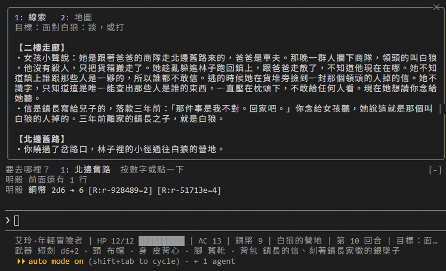

# [Day 28] 這一場花了 Claude Code 多少錢

在遊戲中，不管是打架還是談判，都需要 Claude Code DM 判斷得準、故事說得好。可是從 Day 1 到現在，DM 一直都用同一個模型、同一個 effort：Day 1 選的 Sonnet 5，之後就沒動過。這中間 Claude 5.5 這一代陸續推出：Opus 5.5 在 Day 8（9 月 22 日），Sonnet 5.5 在 Day 14（9 月 28 日），Haiku 5.5 在 Day 23（10 月 7 日）。Sonnet 5.5 的定價跟 Sonnet 5 一樣，但我刻意沒換，因為這個系列從 Sonnet 5 開始講，怕中途換模型前後的畫面會對不上。所以今天來算錢：一回合到底要花多少錢、等多久？換到 Sonnet 5.5 差在哪？換更強的 Opus，值不值得？SubAgent 裁判這種只要回一段 JSON 的小工作，能不能交給便宜的 Haiku 模型？

今天要做三件事：

1. **測量一回合的費用和時間**：用 Day 23 的 headless 跑一局，再用一支新的 `tools\turn_costs.py`，把每一回合的費用列成表。
2. **四組設定比一比**：Claude Code DM 留在 Sonnet 5 還是換 Sonnet 5.5、換成 Opus 並把 effort 調高、裁判換成 Haiku，哪一組比較好？
3. **把決定寫進設定**：介紹專案設定裡的 `model`、`effortLevel`，和裁判定義檔裡的 `model`、`effort`。設定好之後，再走進白狼的營地試試看效果。


## 換上 Day 28 的地城

照下面的步驟換上去：

1. 從 repo 的 [`articles/28/dungeon/`](https://github.com/harry18456/claude-code-dungeon-master/tree/main/articles/28/dungeon) 複製 `scenes\wolf_camp.json` 和 `tools\turn_costs.py` 到你的 dungeon 資料夾。
2. 這幾個檔案直接用 repo 的版本覆蓋：`scenes\old_road.json`、`data\actors.json`、`data\items.json`、`rules.md`、`.claude\settings.json`。
3. 重開 Claude Code。

遊戲世界多了一個場景：白狼的營地。岔路口往林子的小徑現在走得通了，條件是先過守路的人這一關：打倒他、說服他、潛行繞過去或聲東擊西，Day 27 介紹的四種方法，用哪一種都可以。

## 一回合要花多少錢

Day 1 教過用 `/model` 和 `/effort` 選模型和 effort；Day 23 也提過，headless 印出的 JSON 裡有 `total_cost_usd`（花了多少錢）和 `duration_ms`（花了多少毫秒）。今天把這兩件事接起來：先用 `run_turns.sh` 跑一局，再用 `tools\turn_costs.py` 把每一回合的數字列出來。

```
& "C:\Program Files\Git\bin\bash.exe" tools/run_turns.sh tools/inputs.delegate.txt reports/sonnet-medium
uv run --no-project tools/turn_costs.py reports/sonnet-medium
```

`total_cost_usd` 是整段對話累計到目前為止的花費，所以腳本會把前後兩回合的數字相減，算出這一回合自己花了多少。`inputs.delegate.txt` 只有兩回合：第一回合是接委託；第二回合是一個需要交給裁判的創意行動，內容是請披斗篷的人喝到爛醉，再趁他睡著翻他的紙條。第二回合會叫出 `rules-judge` 子代理，所以 DM 和裁判兩邊的費用都看得到。

第一次跑的結果（`run_turns.sh` 沒指定 `MODEL` 時用別名 `sonnet`，也就是最新的 Sonnet 5.5；DM 和裁判用同一個模型）：

| 回合 | 模型 | 這回合費用 | 秒數 | 輸入 token | 輸出 token | 步數 |
|---|---|---|---|---|---|---|
| 01 | claude-sonnet-5-5 | $0.076 | 11 | 103,429 | 746 | 5 |
| 02 | claude-sonnet-5-5 | $0.077 | 21 | 147,177 | 1,147 | 5 |

「步數」是 Claude Code DM 這一回合想了幾輪：每用一次工具算一步，最後回話也算一步。第一回合接委託走了 5 步：找工具、看狀態、看場景、檢定，最後回話，花了 11 秒、0.076 美元。第二回合交給裁判：裁判自己讀規則書、看場景、回一段 JSON，DM 再照裁判的判斷呼叫 `resolve_check`，花了 21 秒、0.077 美元。輸入的 token 一回合就超過十萬，因為 `CLAUDE.md`、規則書和工具說明，每一步都要重新帶上；不過其中大部分是前面送過的內容，會走快取（重複送出的內容，用便宜很多的價格計算），費用才壓得住。

裁判判的是 `{"rule_id": "steal", "target_id": "cloaked"}`，也就是對披斗篷的人用偷竊，理由是「玩家要的是趁對方醉倒時拿到桌上的紙條，最接近的動詞是偷竊；規則寫請人喝過酒是優勢，灌酒當作鋪墊」。跑了三次，三次都判一樣。等一下換模型的時候，就拿這個答案來對照。

## 四組設定比一比

這次比較四組設定：A 組是上面第一次跑的設定，DM 用 Sonnet 5.5；B 組把 DM 換成 Opus，effort 也調高；C 組只把裁判換成比較小的 Haiku；D 組把 DM 釘回 Sonnet 5，也就是前 27 天實際在玩的那一個。A、B、C 三組用的都是 Claude 5.5 這一代，紀錄裡的 `modelUsage` 寫的是 `claude-sonnet-5-5`、`claude-opus-5-5`、`claude-haiku-5-5`。

D 組要回答的是開頭那個問題：Sonnet 5.5 的定價跟 Sonnet 5 一樣，換過去到底差在哪。`run_turns.sh` 的 `MODEL` 寫別名 `sonnet`，跑的是最新的 5.5；要跑 Sonnet 5，就寫完整的模型 ID `MODEL=claude-sonnet-5` 釘住。

| 組 | DM 模型 | DM effort | 裁判模型 | 怎麼設 |
|---|---|---|---|---|
| A | Sonnet 5.5 | medium | 跟 DM 一樣 | `MODEL` 不指定，走別名 `sonnet`；跟今天的 `settings.json` 一樣 |
| B | Opus | high | 跟 DM 一樣 | `MODEL=opus`，`settings.json` 的 `effortLevel` 改 `high` |
| C | Sonnet 5.5 | medium | Haiku，effort low | `rules-judge.md` 加 `model: haiku`、`effort: low` |
| D | Sonnet 5（前 27 天玩的） | medium | 跟 DM 一樣 | `MODEL=claude-sonnet-5`，用完整 ID 釘住 |

每一組都用同一份 `inputs.delegate.txt`，各跑三次，下表列的是三次結果的範圍：

| 組 | 每局費用 | 每局秒數 | 第二回合（委派）費用 | 裁判判了什麼 |
|---|---|---|---|---|
| A Sonnet 5.5 | $0.13～0.15 | 31～36 | $0.055～0.077 | 三次都 `steal cloaked` |
| B Opus | $0.26～0.30 | 40～57 | $0.117～0.158 | 一次 `steal cloaked`，兩次 `interact marlda_ale`（先買酒） |
| C 裁判 Haiku | $0.11 | 27～30 | $0.037（裁判自己只花 $0.001） | 一次 `steal cloaked`，兩次 `persuade cloaked` |
| D Sonnet 5 | $0.16～0.25 | 34～59 | $0.061～0.070 | 一次 `steal cloaked`，兩次 `persuade cloaked` |

B 組每一局的費用大約是 A 組的兩倍，時間也長了不少，大約是 1.5 倍。輸出的 token 也多一些，因為 Opus 的回覆寫得比較長。

比較有意思的是，四組裡裁判判的結果不一樣。A 組（Sonnet 5.5）三次都把「灌醉再翻紙條」判成一次 `steal`，請喝酒算是優勢。B 組（Opus）有兩次判成 `interact marlda_ale`，意思是先去跟梅拉買酒，這一步做完再說。兩種判法都說得通：Opus 會把行動拆得比較細，Sonnet 則是直接抓重點。沒有哪一種比較對，但拆得細，就代表要多玩一回合，多一回合就要多花一回合的錢。

C 組（裁判換成 Haiku）判出兩種結果：一次 `steal`，兩次 `persuade`，也就是直接請披斗篷的人讓你看那張紙條。這樣判不算錯，但離玩家「灌醉再翻」的本意遠了一點；而且說服失敗的話，對方會開始警戒，之後再偷就有劣勢。整體來說，Haiku 判得比較保守。

D 組（前 27 天在玩的 Sonnet 5）判的結果跟 C 組一樣分成兩種：一次 `steal`，兩次 `persuade`。錢跟 A 組差不多，兩代的定價本來就一樣；第一局的第一回合貴一些（0.184 美元），應該是新資料夾第一次跑、快取沒命中。時間比 5.5 長一些。也就是說，從 Sonnet 5 換到 5.5，費用沒差，變的是判斷：5.5 三次都判成同一種，Sonnet 5 則跟 Haiku 一樣分成兩種。

再來看錢。C 組的第二回合，從 A 組的 0.055～0.077 美元降到 0.037 美元。可是裁判自己只花了 0.001 美元，所以省下來的錢，大部分不是因為裁判變便宜了，而是裁判回得比較短，DM 接下來要做的步驟也跟著變少（C 組 3 步，A 組 5 步）。裁判的費用，在整局裡本來就只占一小部分。

把四組放在一起看：

- **DM 換成 Opus**：費用多一倍，時間也比較長，裁判的判斷從「一次偷」變成「先買酒」。判得不是比較對，而是拆得比較細。
- **裁判換成 Haiku**：每局大約省下兩成，但判得比較保守。裁判本身的費用本來就很少，省下來的主要是 DM 後面少做的步驟。
- **DM 換成 Sonnet 5.5**：三次的判斷都一樣，費用和時間都在中間。
- **DM 留在 Sonnet 5**：費用跟 5.5 差不多、時間長一些，判斷像 Haiku 一樣分成兩種。

最後決定讓 Claude Code DM 從 Sonnet 5 換成 Sonnet 5.5，effort 用 `medium`，SubAgent 裁判也跟 DM 一樣。原因不是 Sonnet 5.5 最好，而是三次測下來，Sonnet 5.5 的判斷最穩定，錢又跟 Sonnet 5 一樣，後面幾天就直接用 5.5 來做；而且只要把下面這些設定寫清楚，之後想怎麼換，隨時都能換。

## 把決定寫進設定

### 專案的 model 和 effortLevel

`.claude\settings.json` 裡可以寫這兩個設定：

```json
{
  "model": "sonnet",
  "effortLevel": "medium"
}
```

- `model`：在這個專案開 Claude Code 時要用的模型。用 `/model` 選的模型，會存成你帳號的預設；寫在這裡的設定，只對這個資料夾有效。啟動時加上 `--model`，可以臨時蓋過這個設定一次。`sonnet` 這種寫法是別名，意思是「現在最新的 Sonnet」，今天是 Sonnet 5.5；下一代 Sonnet 出來，別名會自動跟過去，上面量到的費用和判斷也會跟著變。要釘住版本，就寫完整的模型 ID，例如 `claude-sonnet-5-5`。我選別名而不是釘住 `claude-sonnet-5-5`，因為今天已經示範了換代要怎麼量：下一代出來，再跑一次 `turn_costs.py`，費用和判斷有沒有變，一看就知道。
- `effortLevel`：有 `low`、`medium`、`high`、`xhigh` 四個等級。要注意，打 `/effort` 改的不是這個設定，而是存進另一個叫 `modelSettings` 的設定裡，每個模型各記一個值；兩邊都有寫的時候，以 `modelSettings` 為準。

另外還有一個 `maxEffortLevel` 設定，用來設上限：不管 `/effort`、`--effort` 或子代理要求多高的 effort，最高都只會到這個值。如果好幾個設定檔都有設，就取最低的那一個。

之前沒寫這些設定的時候，用的就是帳號的預設；寫了之後，不管是誰打開這個資料夾、他帳號的預設是什麼，用的都是這一組，DM 也從這一刻起換成 Sonnet 5.5。想用 Opus 玩一場，啟動時加上 `--model opus` 就好，不用改檔案。

### 裁判的 model 和 effort

Day 18 的子代理定義檔，也能指定要用哪個模型：

```yaml
---
name: rules-judge
description: 規則裁判。…
tools: Read, mcp__dungeon__get_current_scene
omitClaudeMd: true
model: haiku
effort: low
---
```

`model` 可以填 `sonnet`、`opus`、`haiku`、`fable`、完整的模型 ID，或是 `inherit`（跟 DM 用一樣的模型）。Claude Code 會照下面的順序，決定子代理要用哪個模型，排在前面的優先：

1. DM 交給子代理時，另外指定的 `model`。
2. 定義檔裡寫的 `model`。寫 `inherit` 就是跟 DM 一樣。
3. 環境變數 `CLAUDE_CODE_SUBAGENT_MODEL`。
4. 上面都沒有指定，就用 DM 自己的模型。

`effort` 一樣是那四個等級，再多一個 `max`。寫了之後會蓋過 DM 的 effort，但還是超不過 `maxEffortLevel` 設的上限。

最後，裁判的定義檔我沒有加 `model` 和 `effort`，讓裁判跟 DM 用一樣的設定，效果就跟寫 `inherit` 一樣。實際測下來，換成 Haiku 每局只省兩成左右，而且這份測試有一半的回合都交給了裁判；正常玩的時候裁判很少出場（Day 19 改過），省下的錢會更少。裁判卻判得比較保守，只要判錯一次，玩家就要多玩一回合，那一回合花的錢，就比省下來的還多。等之後 Skill 和子代理變多了，再把便宜的小工作交給小模型。

## 玩玩看: 走進營地

> 小徑盡頭是一片林間空地，篝火燒得正旺，木柴偶爾爆出火星。火邊堆著商隊的貨箱，一個灰髮的男人坐在旁邊，腰間掛著長劍，胸前一枚銀墜子被火光映得發亮。
>
> 他抬眼看見你，並不驚訝，只是手慢慢移到了劍柄附近，沒有起身。
>
> 「守路的沒攔住妳，」他說，聲音低而平，「那就是有話要說的人了。」

白狼不好說話，也不好打：他的 HP 18、AC 14，劍的傷害是 d8+2。手上有商隊清單或鎮長的信，說服他會容易一點。不過今天先試另一件事：偷他胸前的墜子。

> 你趁他盯著篝火的那一瞬間靠近，手指勾住銀墜子的細鍊，輕輕一扯。鍊扣應手而開，連同他腰間錢袋裡的幾枚銅幣，一起滑進你的掌心。白狼的眼神沒有動，火光照著他半邊的臉，他還沒發覺。
>
> 你低頭看墜子，背面刻著一枚家徽，和鎮長那封信上的印記一模一樣。你手裡的銅幣也多了六枚。
>
> 骰子：
> 偷竊白狼 16＋2＝18，對 DC 15，成功 [R:r-b88215=16]
> 銅幣 2d6 → 6 [R:r-928489=2] [R:r-51713e=4]

擲到 16，加上艾玲的 +2 是 18，過了 DC 15，墜子到手。對白狼偷竊的 DC 本來是 20，引擎看艾玲身上有鎮長的信，照規則書的「籌碼」把難度降了一檔；這是引擎自己算的，事件紀錄裡寫著「籌碼 clue_letter：DC 降一檔」，DM 不用知道。墜子背面的家徽和信上的印記一樣，艾玲手上現在有了實物。

打 `/book` 看線索頁：女孩說的話、信的內容和岔路口的小徑都記著；狀態列的背包，除了鎮長的信，多了那枚銀墜子。



偷不一定每次都這麼順：失敗的話，白狼會開始提防艾玲（Day 18 說過的「警戒」），之後不管是再偷一次還是說服他，都會有劣勢。

## 目前還有什麼問題嗎？

信和墜子把事情串起來了：白狼就是鎮長離家三年的兒子，鎮長一直希望他回家。可是真的要打，艾玲打不過他。明天來看看，打不過的時候，玩家會想出什麼歪點子，我們這套地城遊戲又擋不擋得住。

今天結束時 `dungeon` 資料夾的完整內容在 [articles/28/dungeon](https://github.com/harry18456/claude-code-dungeon-master/tree/main/articles/28/dungeon)，給大家參考。

## 目前學會的 Claude Code 機制

- ✅ [Day 1](https://ithelp.ithome.com.tw/articles/10410444)：安裝與登入、四種介面；`/model`、`/effort`、`/usage`
- ✅ [Day 2](https://ithelp.ithome.com.tw/articles/10410920)：session：`.jsonl`、`--resume`、`-c`、`/resume`、`cleanupPeriodDays`
- ✅ [Day 3](https://ithelp.ithome.com.tw/articles/10412229)：CLAUDE.md：三層、`@` 匯入、`/init`；`/context`
- ✅ [Day 4](https://ithelp.ithome.com.tw/articles/10412897)：內建工具：Read／Bash／Edit；`Ctrl+O`
- ✅ [Day 5](https://ithelp.ithome.com.tw/articles/10413695)：checkpoint：`/rewind`、`/branch`
- ✅ [Day 6](https://ithelp.ithome.com.tw/articles/10414052)：Skill：`SKILL.md`、`description`、skill-creator
- ✅ [Day 7](https://ithelp.ithome.com.tw/articles/10414950)：權限：權限模式、`Shift+Tab`、`/permissions`、allow／ask／deny、`settings.json`
- ✅ [Day 8](https://ithelp.ithome.com.tw/articles/10415525)：Skill：`$ARGUMENTS`、`argument-hint`、`!` 展開
- ✅ [Day 9](https://ithelp.ithome.com.tw/articles/10415783)：Skill：`disable-model-invocation`、`user-invocable`、`allowed-tools`
- ✅ [Day 10](https://ithelp.ithome.com.tw/articles/10416355)：Plan Mode：`/plan`、`Ctrl+G`
- ✅ [Day 11](https://ithelp.ithome.com.tw/articles/10416813)：Hook：`Stop`、`UserPromptExpansion`、`PostToolUse`、`matcher`、`if`、`/hooks`
- ✅ [Day 12](https://ithelp.ithome.com.tw/articles/10417400)：Hook：`PreToolUse`、exit 2、`tool_input`、`Edit|Write`、UTF-8 with BOM；deny 保護 Hook
- ✅ [Day 13](https://ithelp.ithome.com.tw/articles/10417813)：Hook：`last_assistant_message`、`systemMessage`；帳本與票根
- ✅ [Day 14](https://ithelp.ithome.com.tw/articles/10418294)：狀態列：`statusLine`、`refreshInterval`；`uv run`
- ✅ [Day 15](https://ithelp.ithome.com.tw/articles/10418977)：MCP：host／client／server、stdio、Streamable HTTP、`claude mcp add`、`.mcp.json`、`/mcp`、`mcp__server__tool`、`ToolError`；`uvx`
- ✅ [Day 16](https://ithelp.ithome.com.tw/articles/10419326)：MCP：多個工具、回傳 JSON 與錯誤；Hook：`tool_response`、`async`
- ✅ [Day 17](https://ithelp.ithome.com.tw/articles/10419772)：權限：`Read(path)` deny；Hook：`PreToolUse` 擋 Bash、`permissionDecision`；`!` 展開失敗
- ✅ [Day 18](https://ithelp.ithome.com.tw/articles/10420242)：Subagent：`.claude/agents/`、`name`、`description`、`Agent`、背景執行、`@agent-名字`、`/tasks`
- ✅ [Day 19](https://ithelp.ithome.com.tw/articles/10420547)：Subagent：`tools`、`omitClaudeMd`、`subagents/`；`env`、`CLAUDE_CODE_DISABLE_BACKGROUND_TASKS`
- ✅ [Day 20](https://ithelp.ithome.com.tw/articles/10420976)：auto memory：`MEMORY.md`、`type`、`/memory`、`autoMemoryEnabled`
- ✅ [Day 21](https://ithelp.ithome.com.tw/articles/10421396)：Hook：`SessionStart`、`startup`／`resume`／`clear`／`compact`／`fork`、`source`、`additionalContext`；`/clear`、`/compact`
- ✅ [Day 22](https://ithelp.ithome.com.tw/articles/10421723)：output style：`.claude/output-styles/`、`keep-coding-instructions`、`outputStyle`、`/output-style`
- ✅ [Day 23](https://ithelp.ithome.com.tw/articles/10422123)：headless：`claude -p`、`--output-format json`、`--resume`、`--allowedTools`、`--permission-prompts`、`--setting-sources`、`--strict-mcp-config`；Hook：`UserPromptSubmit`、`MessageDisplay`、`prompt_id`
- ✅ [Day 24](https://ithelp.ithome.com.tw/articles/10422460)：plugin：`plugin.json`、`hooks/hooks.json`、`${CLAUDE_PLUGIN_ROOT}`、`CLAUDE_PROJECT_DIR`、`dm:` 前綴、`mcp__plugin_dm_dungeon__`、`claude plugin validate`、`--plugin-dir`；marketplace：`marketplace.json`、`/plugin install --marketplace`、`enabledPlugins`、`extraKnownMarketplaces`
- ✅ [Day 25](https://ithelp.ithome.com.tw/articles/10422629)：mod：`hooks/register.tsx`、`on(事件, 條件, 函式)`、`session.start`、`turn.start`、`tool.call`、`turn.complete`、`command.run`、`ui.render`、`$.command.register`、`$.ui.open`、`$.process.run`、`$.prompt.fill`、`claude plugin test`、`@skills-dir`；`"tui": "fullscreen"`、`/tui`
- ✅ [Day 26](https://ithelp.ithome.com.tw/articles/10422877)：Skill 觸發率：該叫／不該叫的句子、多跑幾次算比例、`description` 改前改後；`claude plugin eval`、`tool_used`、`tools/skill_rate.py`
- ✅ [Day 27](https://ithelp.ithome.com.tw/articles/10423286)：Hook：`SessionEnd`、`reason`、`FileChanged`、`file_path`、`event`、`SessionStart` 的 `async`
- ✅ Day 28：設定：`model`、`effortLevel`、`modelSettings`、`maxEffortLevel`；Subagent：`model`、`effort`；headless：`total_cost_usd`、`duration_ms`、`modelUsage`
