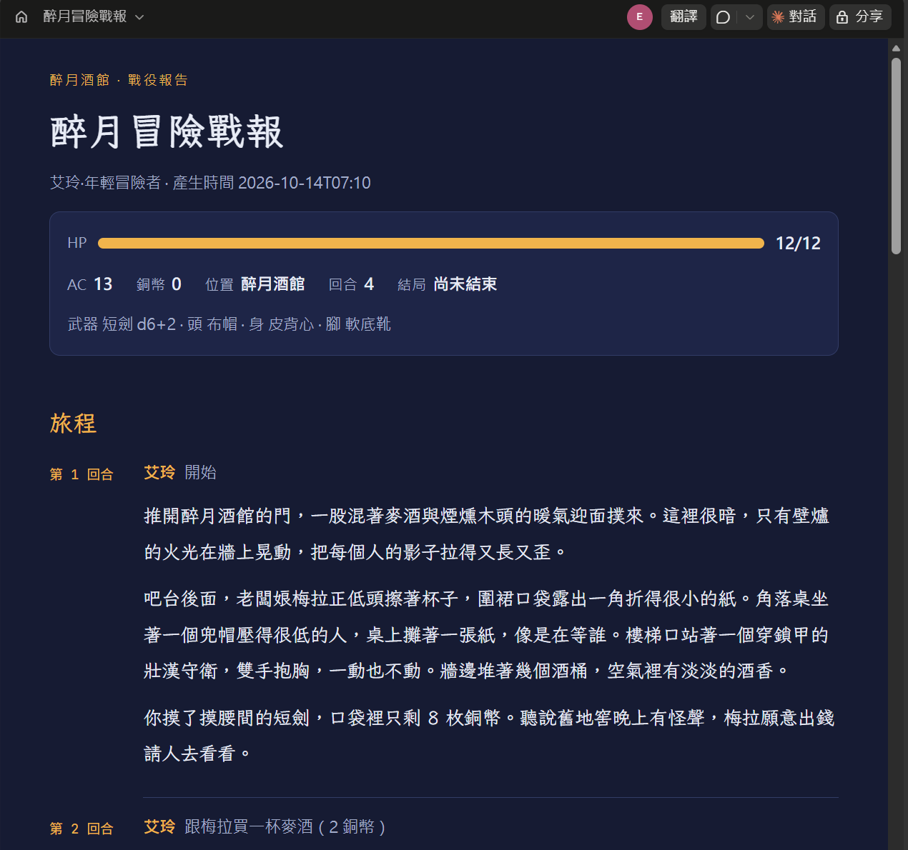
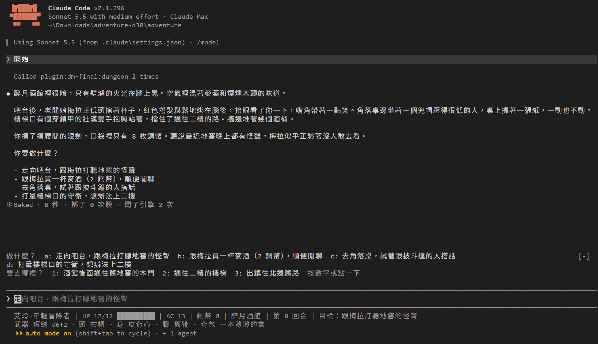

# [Day 30] 戰役報告：用 /report 和 Artifact 把冒險發布出去，再把整個地城帶走

艾玲站在篝火前，三種收場都在引擎裡等著。怎麼收尾，留給大家自己玩；今天要講的是收尾之後的事：把這場冒險的紀錄做成一份戰役報告，發布成一個網頁，最後再把整個地城帶走。

今天要做三件事：

1. **結局怎麼算結束**：每一種結局，引擎都會設一個旗標；故事說完之後，手冊、配樂和 DM 會各做一件事。
2. **`/report` 和 Artifact**：把引擎的紀錄做成戰役報告，再用 Claude Code 的 `Artifact` 工具發布成 claude.ai 上的網頁。
3. **整理這 30 天**：說明完整的遊戲怎麼安裝，列出 30 天的機制對照表，再把 30 張封面串成一段動畫。


## 換上 Day 30 的地城：完整版

這是最後一次換地城了。這次不用再複製整個資料夾，改成裝 plugin。

開始之前，電腦上要有兩樣東西：Day 14 裝的 uv，和 2.1.287 以上的 Claude Code。引擎、Hook 和狀態列都是 Python 寫的，靠 `uv run` 執行，uv 會自己下載 Python，所以不用另外裝 Python；手冊是 Day 25 的 mod，舊版的 Claude Code 跑不起來。版本可以用 `claude --version` 看，太舊就打 `claude update`。

裝法有三步：

1. 從 repo 複製 [`articles/30/adventure/`](https://github.com/harry18456/claude-code-dungeon-master/tree/main/articles/30/adventure) 到一個新資料夾。裡面只有 Day 24 提過、plugin 帶不走的四樣東西：`CLAUDE.md`、`.claude\settings.json`、`.claude\statusline.py`，和一份新局的 `state.json`。
2. 在那個資料夾開終端機，先把 plugin 裝好，再開 Claude Code。這次裝的不是 Day 24 的 `dm`，而是另一個叫 `dm-final` 的完整版：

   ```
   claude plugin marketplace add harry18456/claude-code-dungeon-master --scope project
   claude plugin install dm-final@dungeon-master --scope project
   ```

   ![在 PowerShell 進到 C:\Users\harry\Downloads\adventure-d30\adventure，打 claude plugin marketplace add harry18456/claude-code-dungeon-master --scope project：依序印出 SSH not configured, cloning via HTTPS、Refreshing marketplace cache、Cloning repository、Clone complete, validating marketplace、Cleaning up old marketplace cache，最後一行是 ✔ Successfully added marketplace: dungeon-master (declared in project settings)；接著打 claude plugin install dm-final@dungeon-master --scope project，印出 ✔ Successfully installed plugin: dm-final@dungeon-master (scope: project)](assets/04-plugin-install.png)

   兩行跑完，最後一行都是 `✔ Successfully` 開頭，這樣就裝好了。

   第一行登記 marketplace，第二行安裝 plugin。兩行都加上 `--scope project`，範圍跟 Day 24 一樣是 project，別用 user，避免影響到其他專案：第一行不加的話，marketplace 會寫進使用者層的 `settings.json`。plugin 的檔案不會放進這個資料夾，而是下載到 `C:\Users\你的帳號\.claude\plugins\cache\` 裡；project 範圍只是在這個資料夾的 `.claude\settings.json` 記下要用這個 marketplace、要啟用 `dm-final`。其實 `settings.json` 裡本來就寫好了這兩件事，所以這兩行主要是把檔案真的抓下來。

3. 打 `claude`，在信任對話框選「Yes, I trust this folder」就能開始玩；游標一開始停在「No, exit」，要先按方向鍵往下。引擎、世界、Skill、Hook、配樂和手冊都在 plugin 裡，存檔和日誌則寫在你的資料夾。plugin 的 Skill 前面都會多一個 `dm-final:`，例如 `/dm-final:report`；沒有跟別的指令撞名的話，直接打 `/report`、`/equip` 也可以。想接著自己在營地的進度玩，就把原本 dungeon 資料夾的 `state.json` 和 `.game\` 複製過來，再打「繼續」；想從頭玩，就直接打「開始」。

想看程式碼，或是想照前幾天的方式整份換掉的話，完整的 dungeon 資料夾也放在 repo 的 [`articles/30/dungeon/`](https://github.com/harry18456/claude-code-dungeon-master/tree/main/articles/30/dungeon)。這一版什麼都沒剪掉，三種結局、尾聲和彩蛋都在裡面。跟 Day 29 比，多了 `/report` 和 `/equip` 兩個 Skill（`.claude\skills\report\`、`.claude\skills\equip\`）、做戰報的 `tools\build_report.py`，以及 `gamectl.py` 的 `report`、`equip` 兩個指令；世界檔（`scenes\`、`data\`、`rules.md`）、`CLAUDE.md` 和 `.claude\settings.json` 也都換成了最終版。另外還多了一個 `CHANGES.md`，記錄每一天的資料夾跟前一天差在哪裡。

## 結局怎麼算結束

在白狼的營地，有三種方式可以收場：說出他的身分、跟他談和，或是打倒他。不管走到哪一種，引擎都會在 `state.json` 的 `flags` 裡記下這種結局的旗標（`ending_truth`、`ending_peace` 或 `ending_fight`），同時再記一個三種結局共用的 `ending`。有了 `ending` 之後，DM 用 `get_current_scene` 看場景時，回傳的 `game_over` 就會變成 `true`，DM 就知道故事已經說完了。旗標一設下，接下來有三件事會自動發生：

- **手冊謝幕**：故事說完的那一回合，手冊會自己翻開，停在線索頁；輸入框上方的出口按鈕也會收起來，換成一行「故事說完了。打 /report 可以寫成冒險日誌」。這是手冊 mod 在回合結束（`turn.complete`）時，發現引擎回報的 `over` 從 false 變成 true 才做的，所以只會自動打開這一次。不過 mod 自己打開的窗格，終端機要有 144 欄寬，Claude Code 才會畫出來；終端機比較窄的話，就只會看到輸入框上方那一行，手冊要自己打 `/book` 才會打開。
- **配樂換曲**：Day 27 的 `FileChanged` Hook 一直盯著 `state.json`，一看到 `ending` 這個旗標，就把配樂換成只播一次的 `ending.mp3`，播完就安靜下來。
- **DM 提醒 `/report`**：`CLAUDE.md` 裡多寫了一條，遊戲結束時要提醒玩家一次，可以打 `/report`。

## /report：把冒險紀錄做成戰役報告

```yaml
---
name: report
description: 產出這場冒險的日誌與戰報。冒險結束或告一段落時使用：把引擎的事實紀錄潤成日誌，並把戰報發布成 Artifact。只由玩家觸發。
disable-model-invocation: true
allowed-tools: Bash(uv run --no-project gamectl.py report)
---
```

跟 Day 21 的 `/save` 一樣，這個 Skill 會做兩件事：

1. 印出遊戲記下的原始紀錄，也就是目前的狀態（`state`）、每一顆骰子（`rolls`）以及每一筆事件（`events`），再加上幾個統計數字：擲了幾次骰、攻擊幾次又命中幾次、檢定幾次又成功幾次、倒下幾次，以及走到了哪個結局。
2. 用 `tools\build_report.py` 把這些紀錄做成一頁 HTML，存成 `.game\report.html`。

Claude Code DM 拿到紀錄之後，會依照 Skill 的指示，把這些事實寫成三到五段冒險日誌。

`build_report.py` 會把三種資料分開來處理：玩家和 DM 說了什麼（Day 23 的 `story.jsonl`）、引擎做了什麼（`events.jsonl`、`rolls.jsonl`），以及世界裡有什麼（物品、人物、結局）。做出來的頁面分成七節：

| 節 | 內容 | 來源 |
|---|---|---|
| 旅程 | 每一回合一段，放玩家打的字和 Claude Code DM 的回覆 | `story.jsonl` |
| 戰績 | 出手幾次、命中幾次，造成和受到多少傷害，檢定成功幾次、倒下幾次，還有走過的路線 | `events.jsonl` |
| 發現 | 拿到哪些線索和物品，說動了誰，又從誰身上偷了東西 | `events.jsonl`、物品資料 |
| 結局 | 走到哪一種結局，還沒走完就寫「尚未結束」；另外列出最後身上的裝備 | `state.json` |
| 事件紀錄 | 引擎記下的每一筆事件，附上票根 | `events.jsonl` |
| 骰子帳本 | 每一顆骰子的編號、用途、幾面骰、擲出的值和來源（引擎隨機擲出的，或是測試時固定的值） | `rolls.jsonl` |
| 這份報告能證明什麼 | DM 回覆裡貼的票根，有幾張跟上面的骰子帳本對得上、幾張對不上，還有幾顆骰子擲了，DM 卻沒寫進回覆 | 拿 DM 的回覆和帳本比對 |

## 用 Artifact 把戰報發布成網頁

在 claude.ai 聊天的時候，如果請 Claude 做一個網頁、一份文件或一副簡報，做出來的東西會放在對話右邊的一個框裡顯示互動，那個框就叫 Artifact(成品)。而近期 9 月 16 日，Anthropic 把聊天、Cowork 和 Claude Code 三個地方的三種 Artifact 合併成同一套，之後又陸續加了 Docs、Slides、Design、Dashboards、Motion 幾種模板快速建立特定類型的 Artifact。

有幾件事情要先知道：

- **預設只有你自己看得到**。Artifact 分享選單可以邀請特定的人，或是開成「有連結的人都能看」；開成公開之後，對方不用登入 claude.ai 也能看。
- **一個 Artifact 就是一頁，最大 16 MiB（約 16.8 MB）**：發布的檔案要是 HTML 或 Markdown。外部網址的圖片會被擋掉，圖片要轉成一長串文字直接寫進 HTML 裡（這種寫法叫 data URI），所以大圖最容易讓頁面超過上限。
- **不同方案能用的不一樣**。從 Claude Code 發布 Artifact，要 Pro、Max、Team 或 Enterprise 方案；免費方案只能在 claude.ai 聊天裡做 Artifact。Docs、Slides、Design 三種模板所有方案都能用，包含免費方案；Dashboards 還在測試階段（beta），要 Pro 以上；Motion 也還在測試階段，只有 Team 和 Enterprise 才有。

今天我們用到的是最基本的一種：把一個 HTML 檔發布成 Artifact。`/report` 的第二步，就是請 DM 先用 `Read` 讀完 `.game\report.html`，最後再用 `Artifact` 工具發布出去，拿回一個 `claude.ai/artifact/…` 的連結。目前 Skill 的設計是在同一場對話(Session)會分布、更新同一份 Artifact。

要注意的是，發布之前 Claude Code 不會先問你：只要是你自己打的指令讓 DM 發布新的 Artifact，就不會跳出權限對話框。不想發布的話，可以在 `.claude\settings.local.json` 的 `permissions.deny` 加上 `Artifact`，Claude Code DM 就用不到這個工具。Skill 也寫好了退路：這個環境沒有 `Artifact` 工具、被權限擋下，或是發布失敗，DM 就會改成告訴你，戰報放在 `.game\report.html`，用瀏覽器打開就能直接看。

實際打一次 `/dm-final:report`，畫面會像這樣：DM 讀完 `.game\report.html` 就發布出去，接著寫出冒險日誌，最後附上連結，並提醒你這個頁面目前只有你自己看得到。


點開連結，就是 claude.ai 上的戰報頁，內容跟 `.game\report.html` 一樣；右上角的「分享」，就是前面說的分享選單。



## 最終版遊戲跟教學不一樣的地方

最終版遊戲有做了修改，但用到的技術前面教學大致都有提過了。這一節把它們列出來，這樣你拿到最終版的時候，才不會覺得跟文章對不上：

| 改了什麼 | 用的是哪一天的東西 | 為什麼改 |
|---|---|---|
| 拿到二樓那封信，多了一種方法：女孩信任你之後，可以直接請她拿出來，不用擲骰。原本只能去翻她的枕頭底下，翻失敗的話，引擎會鎖住不讓你馬上重試，玩家就卡在那裡 | Day 18 的場景規則：用不擲骰的 `interact`，跟酒館塞錢給守衛是同一種寫法 | 問題不在裁判判錯，而是世界資料只給了一條路，變得很卡 |
| `CLAUDE.md` 改了四處：「裁決」第 3 條補了一句，一個方法被引擎擋下來時，要去看那個東西還列了哪些規則和動詞，換一個再試；每個人身上都帶著一樣可以偷的東西，打倒了也會掉出來；玩家要看背包裡的東西時，照 `get_state` 回傳的 `desc` 來描述，不自己補內容；遊戲結束時提醒一次 `/report` | Day 3 的 CLAUDE.md、Day 17 的 `get_current_scene` | Claude Code DM 碰壁兩次，就直接跟玩家說不行，沒有去看還有沒有別條路。其他三條是配合最終版的彩蛋和結局 |
| DM 給的選項變成按鈕 `a`～`d`，按下去會把選項填進輸入框；打開 `/book send` 的話，按下去就直接送出 | Day 25 的 mod：從 `turn.complete` 拿到 DM 的回覆、用 `ui.render` 畫按鈕、用 `$.prompt.fill` 填字；另外新用到 `$.prompt.submit({ asUser: true })`，和重開 Claude Code 也還記得設定的 `$.store` | 每回合都要照著選項打一次字，太累了 |
| 骰子查帳也畫在畫面上：Claude Code DM 一回完話，就比對引擎發出的票根和回覆裡的票根，引擎沒發過的、發了卻沒貼出來的，都用紅字列出來 | Day 13 的票根、Day 25 的 `tool.call` 和 `turn.complete` | Day 29 的 `Stop` 查帳是在回合結束時擋下來，這個是讓玩家當場看到。兩邊各自獨立運作 |
| 玩家的話像是正常行動，但 Claude Code DM 卻沒讓 SubAgent 引擎評斷要不要做，只有黃字提示「世界沒有變」 | Day 25 的 `turn.start`，加上用 `tool.call` 數 DM 這一回合呼叫了幾次引擎 | Day 26 測量時發現 DM 會自己下判斷 |
| 每回合結束時顯示的那一行，換成像「✻ Cooked · 22 秒 · 擲了 0 次骰 · 問了引擎 2 次」這樣，多了這一回合擲了幾次骰、問了引擎幾次 | Day 25 的 `ui.render`，這次改的是 `TurnDuration` 那一行 |  |
| 故事說完的那一回合，手冊會自己翻開到線索頁 | Day 25 的 `$.ui.open` | 當作故事的謝幕 |
| 新增 `/equip` Skill 和 `gamectl.py equip`，用來換裝備。DM 提醒你換裝時，會寫出完整的指令，例如 `/equip 軟底靴`；寫在選項裡的話，按下去手冊會把指令填進輸入框，按 Enter 就換好 | Day 8 的 `!` 展開、Day 9 的 `disable-model-invocation`、Day 25 的 `$.prompt.fill` | 第二幕撿到短弓和彎刀之後，要能換上去用 |
| 多了第二個 plugin `dm-final`：Day 24 的 `dm` 加上配樂、手冊 mod、`/report`、`/equip` 和完整的世界 | Day 24 的 plugin、Day 25 的手冊 mod、Day 27 的配樂 | 下面「完整遊戲」那一段會講 |
| 狀態列在 plugin 版一開就有艾玲的資料：找不到 MCP server 留下的紙條時，改看 Claude Code 自己記錄的 plugin 安裝位置 | Day 14 的狀態列、Day 24 的 `.game\engine_root.txt` | 狀態列比 MCP server 早畫第一次，原本要打一句話之後才會出現 |

每一項改動，在 repo 的 `CHANGES.md` 裡都有一條紀錄，寫了為什麼改。




## 彩蛋

彩蛋有兩個，這裡只給提示。第一個從 Day 16 的巨鼠就埋下了：巨鼠身上那封寫滿「吱吱吱吱」的信，還有另一隻巨鼠身上的鼠臉畫像，都要戴上一副奇怪的眼鏡才看得懂。第二個在開新局的時候：背包裡會有一本薄薄的書，翻開第一頁看看。

## 30 天的地城

### 完整遊戲

repo 的 [articles/30/dungeon](https://github.com/harry18456/claude-code-dungeon-master/tree/main/articles/30/dungeon) 就是完整版的資料夾；`dm-final` 是完整版 plugin，安裝方法則在開頭寫過了。

### 30 天機制對照表

- ✅ [Day 1](https://ithelp.ithome.com.tw/articles/10410444)：安裝與登入、四種介面；`/model`、`/effort`、`/usage`
- ✅ [Day 2](https://ithelp.ithome.com.tw/articles/10410920)：session：`.jsonl`、`--resume`、`-c`、`/resume`、`cleanupPeriodDays`
- ✅ [Day 3](https://ithelp.ithome.com.tw/articles/10412229)：CLAUDE.md：三層、`@` 匯入、`/init`；`/context`
- ✅ [Day 4](https://ithelp.ithome.com.tw/articles/10412897)：內建工具：Read／Bash／Edit；`Ctrl+O`
- ✅ [Day 5](https://ithelp.ithome.com.tw/articles/10413695)：checkpoint：`/rewind`、`/branch`
- ✅ [Day 6](https://ithelp.ithome.com.tw/articles/10414052)：Skill：`SKILL.md`、`description`、skill-creator
- ✅ [Day 7](https://ithelp.ithome.com.tw/articles/10414950)：權限：權限模式、`Shift+Tab`、`/permissions`、allow／ask／deny、`settings.json`
- ✅ [Day 8](https://ithelp.ithome.com.tw/articles/10415525)：Skill：`$ARGUMENTS`、`argument-hint`、`!` 展開
- ✅ [Day 9](https://ithelp.ithome.com.tw/articles/10415783)：Skill：`disable-model-invocation`、`user-invocable`、`allowed-tools`
- ✅ [Day 10](https://ithelp.ithome.com.tw/articles/10416355)：Plan Mode：`/plan`、`Ctrl+G`
- ✅ [Day 11](https://ithelp.ithome.com.tw/articles/10416813)：Hook：`Stop`、`UserPromptExpansion`、`PostToolUse`、`matcher`、`if`、`/hooks`
- ✅ [Day 12](https://ithelp.ithome.com.tw/articles/10417400)：Hook：`PreToolUse`、exit 2、`tool_input`、`Edit|Write`、UTF-8 with BOM；deny 保護 Hook
- ✅ [Day 13](https://ithelp.ithome.com.tw/articles/10417813)：Hook：`last_assistant_message`、`systemMessage`；帳本與票根
- ✅ [Day 14](https://ithelp.ithome.com.tw/articles/10418294)：狀態列：`statusLine`、`refreshInterval`；`uv run`
- ✅ [Day 15](https://ithelp.ithome.com.tw/articles/10418977)：MCP：host／client／server、stdio、Streamable HTTP、`claude mcp add`、`.mcp.json`、`/mcp`、`mcp__server__tool`、`ToolError`；`uvx`
- ✅ [Day 16](https://ithelp.ithome.com.tw/articles/10419326)：MCP：多個工具、回傳 JSON 與錯誤；Hook：`tool_response`、`async`
- ✅ [Day 17](https://ithelp.ithome.com.tw/articles/10419772)：權限：`Read(path)` deny；Hook：`PreToolUse` 擋 Bash、`permissionDecision`；`!` 展開失敗
- ✅ [Day 18](https://ithelp.ithome.com.tw/articles/10420242)：Subagent：`.claude/agents/`、`name`、`description`、`Agent`、背景執行、`@agent-名字`、`/tasks`
- ✅ [Day 19](https://ithelp.ithome.com.tw/articles/10420547)：Subagent：`tools`、`omitClaudeMd`、`subagents/`；`env`、`CLAUDE_CODE_DISABLE_BACKGROUND_TASKS`
- ✅ [Day 20](https://ithelp.ithome.com.tw/articles/10420976)：auto memory：`MEMORY.md`、`type`、`/memory`、`autoMemoryEnabled`
- ✅ [Day 21](https://ithelp.ithome.com.tw/articles/10421396)：Hook：`SessionStart`、`startup`／`resume`／`clear`／`compact`／`fork`、`source`、`additionalContext`；`/clear`、`/compact`
- ✅ [Day 22](https://ithelp.ithome.com.tw/articles/10421723)：output style：`.claude/output-styles/`、`keep-coding-instructions`、`outputStyle`、`/output-style`
- ✅ [Day 23](https://ithelp.ithome.com.tw/articles/10422123)：headless：`claude -p`、`--output-format json`、`--resume`、`--allowedTools`、`--permission-prompts`、`--setting-sources`、`--strict-mcp-config`；Hook：`UserPromptSubmit`、`MessageDisplay`、`prompt_id`
- ✅ [Day 24](https://ithelp.ithome.com.tw/articles/10422460)：plugin：`plugin.json`、`hooks/hooks.json`、`${CLAUDE_PLUGIN_ROOT}`、`CLAUDE_PROJECT_DIR`、`dm:` 前綴、`mcp__plugin_dm_dungeon__`、`claude plugin validate`、`--plugin-dir`；marketplace：`marketplace.json`、`/plugin install --marketplace`、`enabledPlugins`、`extraKnownMarketplaces`
- ✅ [Day 25](https://ithelp.ithome.com.tw/articles/10422629)：mod：`hooks/register.tsx`、`on(事件, 條件, 函式)`、`session.start`、`turn.start`、`tool.call`、`turn.complete`、`command.run`、`ui.render`、`$.command.register`、`$.ui.open`、`$.process.run`、`$.prompt.fill`、`claude plugin test`、`@skills-dir`；`"tui": "fullscreen"`、`/tui`
- ✅ [Day 26](https://ithelp.ithome.com.tw/articles/10422877)：Skill 觸發率：該叫／不該叫的句子、多跑幾次算比例、`description` 改前改後；`claude plugin eval`、`tool_used`、`tools/skill_rate.py`
- ✅ [Day 27](https://ithelp.ithome.com.tw/articles/10423286)：Hook：`SessionEnd`、`reason`、`FileChanged`、`file_path`、`event`、`SessionStart` 的 `async`
- ✅ [Day 28](https://ithelp.ithome.com.tw/articles/10423591)：設定：`model`、`effortLevel`、`modelSettings`、`maxEffortLevel`；Subagent：`model`、`effort`；headless：`total_cost_usd`、`duration_ms`、`modelUsage`
- ✅ [Day 29](https://ithelp.ithome.com.tw/articles/10423866)：Hook：`Stop` 的 `decision: block`、`reason`、`stop_hook_active`；五道防線：allow／deny、guard、查帳、裁判隔離
- ✅ Day 30：Skill：`/report`；Artifact：`Artifact` 工具、預設私人、不先問就發布、`deny` 擋下、分享連結、16 MiB、模板與方案；mod：`$.prompt.submit`、`$.store`；plugin：同一個 marketplace 的第二個 plugin、`claude plugin marketplace add`、`claude plugin install`、`--scope project`、`version`；Hook：`SessionStart` 的 `watchPaths`

## 結尾


30 天說長不長，說短不短，就算有了草稿跟方向要連續更新真的是一件不太容易的事。

很明顯的這系列文章有很重的 AI 味 XD，實際過程也卻是都是跟 Claude Code 或是 Codex 討論、實驗、寫草稿，可能是功力不夠無法好好地把 AI 味去除掉(融化臉表情)。回頭看看雖然文章和最終遊戲雖然不盡人意，但整體過程中還是學到不少之前沒有注意到的細節，也挺高興在 Claude Code 的幫助下又完成了一項之前未曾想過要做的挑戰。

Claude Code 很夯，網路上的教學也百百種，希望這系列透過 Claude Code 結合 D&D 遊戲的做法能提供不一樣的學習過程(雖然 AI 味很重XD)。然，系列文章中提到的東西也只是 Claude Code 機制的一部分，有很多東西還是可以再深入去研究摸索的，像是 C:\Users\<使用者>\.claude\rules 機制怎運作? Claude Code 的 remote connect 機制、session 之間怎互傳訊息、Claude Code harness 能做到啥程度、Claude Code 的 channel 機制是啥等等等，尤其在 Claude Code 幾乎每天都有更新的狀態下真的蠻多東西可以細細看，看能否在工作使用上幫助更多。

往前看這一年之前 AI 的發展真的好快，不知未來會變得怎樣呢?感謝大家觀看這系列，也感謝我自己有完成XD 希望這系列能讓大家有些收穫，能帶一些知識走! (得趕快發文去上班了)